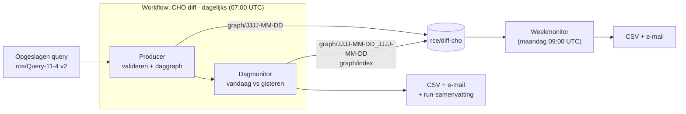

# CHO Diff Monitor

[](https://github.com/cultureelerfgoed/cho-diff-monitor/actions/workflows/ci.yml)
[](https://github.com/cultureelerfgoed/cho-diff-monitor/actions/workflows/daily.yml)

De CHO Diff Monitor signaleert veranderingen in de CHO linked data van de
Rijksdienst voor het Cultureel Erfgoed (RCE). Elke dag worden de aantallen
instanties per klasse en per eigenschap vastgelegd. Die stand wordt vergeleken
met de dag ervoor. Het resultaat komt als RDF-graph in TriplyDB, als CSV en als
e-mailrapport. Op maandag volgt een weekoverzicht.

> **Wat het wel en niet is.** De monitor vergelijkt *tellingen*, geen
> afzonderlijke triples. Wijzigingen waarbij de aantallen gelijk blijven,
> vallen buiten beeld. Er zijn geen drempelwaarden: elk verschil telt.

## Hoe het werkt



| Onderdeel | Doet | Uitvoer |
|---|---|---|
| **Producer** | Haalt de tellingen op via de opgeslagen TriplyDB-query, controleert ze en legt ze vast | Daggraph `…/graph/JJJJ-MM-DD` |
| **Dagmonitor** | Vergelijkt vandaag met gisteren, inclusief nieuwe en verdwenen items | Resultaatgraph `…/graph/JJJJ-MM-DD_JJJJ-MM-DD`, indexgraph, CSV, e-mail |
| **Weekmonitor** | Vergelijkt de laatste volledige kalenderweek (ma t/m zo) | CSV, e-mail |

Producer en dagmonitor zitten in één workflow. De monitor start pas als de
producer klaar is. Alles schrijft naar `rce/diff-cho`; de brondata in
`rce/cho` wordt nooit gewijzigd.

## Workflows

| Workflow | Planning (UTC) | NL winter / zomer |
|---|---|---|
| `CHO diff · dagelijks` ([daily.yml](.github/workflows/daily.yml)) | dagelijks 07:00 | 08:00 / 09:00 |
| `CHO diff · wekelijks` ([weekly.yml](.github/workflows/weekly.yml)) | maandag 09:00 | 10:00 / 11:00 |
| `CI` ([ci.yml](.github/workflows/ci.yml)) | bij push en pull request | |
| `Keep-alive` ([keep-alive.yml](.github/workflows/keep-alive.yml)) | 1e en 15e van de maand | |

De cron-tijden zijn UTC. De scripts rekenen zelf met kalenderdagen in
`Europe/Amsterdam`. Een run rond middernacht krijgt dus de juiste Nederlandse
datum.

### Handmatig starten

**Actions → CHO diff · dagelijks → Run workflow** biedt:

| Invoer | Betekenis |
|---|---|
| Stappen | *producer en monitor*, *alleen producer* of *alleen monitor* |
| Datum | Alleen monitor: welke dag vergelijken met de dag ervoor (leeg = vandaag) |
| Forceren | Bestaande graphs overschrijven |
| Proefdraai | Niets uploaden en geen mail versturen; CSV, TriG en mail komen als artifact |

De weekmonitor heeft *Week van* (een willekeurige dag in de gewenste week) en
*Proefdraai*.

### Bestaande graphs

Staat de daggraph of resultaatgraph voor die datum er al (bijvoorbeeld na een
handmatige run), dan wordt hij **niet** opnieuw geüpload. De run geeft dan een
waarschuwing. Overschrijven gebeurt alleen met *Forceren*. Zonder deze controle
zou de TriplyDB CLI een hernoemde kopie naast de bestaande graph zetten.

## Rapportages

**Dagmail** (`DIFF CHO JJJJ-MM-DD · n afwijkingen`)
- Kerncijfers en een tabel met alle afwijkingen, grootste verschil bovenaan.
- Nieuwe of verdwenen items krijgen een label en kleuren het rapport geel.
- Links naar de resultaatgraph en de workflow-run.
- Bijlage: `diff-cho-JJJJ-MM-DD_JJJJ-MM-DD.csv` met alle items
  (`item, aantalVandaag, aantalGisteren, verschil`).

**Weekmail** (`DIFF CHO week JJJJ-MM-DD – JJJJ-MM-DD · …`)
- Alle items die ergens in de week veranderden, met netto verschil en verloop per dag.
- Bijlage: `diff-cho-week-JJJJ-MM-DD_JJJJ-MM-DD.csv` met zeven dagtellingen,
  zes dagverschillen en `totaalVerschil` (zondag min maandag).

**Foutmail** (`… · FOUT in producer|dagmonitor|weekmonitor`). Gaat uit bij
elke fout: ontbrekende daggraphs, een SPARQL- of uploadfout, of een ongeldig
producerresultaat. De run faalt daarna zichtbaar in Actions.

Elke run zet bovendien een samenvatting op de run-pagina en bewaart CSV, TriG
en de mail (`.eml` en `.html`) als artifact.

## Controles

De producer stopt, zonder iets te uploaden, als de opgeslagen query:
- geen geldige Turtle of een lege graph oplevert;
- andere eigenschappen dan `ceo:aantalInstanties` of geen gehele getallen bevat;
- precies zoveel tellingen oplevert als de `LIMIT` (500). Het resultaat is dan
  waarschijnlijk afgekapt.

Daarnaast waarschuwt de producer in twee gevallen:
- de opgeslagen query wijkt af van [queries/query-producer.rq](queries/query-producer.rq);
- er is een nieuwere versie van de opgeslagen query dan de versie in `config.toml`.

De monitors stoppen met een foutmail als een benodigde daggraph ontbreekt.
Mislukte HTTP-verzoeken naar TriplyDB worden maximaal drie keer herhaald
(alleen bij netwerk- of serverfouten). Verder is er geen automatisch herstel.

## Configuratie

Instellingen staan in [config.toml](config.toml): TriplyDB-account en dataset,
de opgeslagen query, graph-URI's, vocabulaire, tijdzone en mailadressen.

Repositorysecrets (**Settings → Secrets and variables → Actions**):

| Secret | Gebruik |
|---|---|
| `TRIPLYDB_TOKEN` | Upload naar `rce/diff-cho` |
| `GMAIL_USERNAME` | Afzendaccount voor de rapportages |
| `GMAIL_APP_PASSWORD` | App-wachtwoord van dat account |

## Lokaal draaien

```bash
python -m pip install -r requirements-dev.txt
```

Proefdraai van de dagmonitor voor een bepaalde dag. Er wordt niets geüpload en
geen mail verstuurd. Alles komt in `output/`:

```bash
python -m chodiff compare --date 2026-11-16 --dry-run
```

```bash
python -m chodiff weekly --week-of 2026-11-12 --dry-run
```

```bash
python -m chodiff produce --dry-run
```

Tests en lint:

```bash
python -m pytest
```

```bash
ruff check . && ruff format --check .
```

Een echte upload vraagt `TRIPLYDB_TOKEN` en de TriplyDB CLI (`TRIPLYDB_CLI` of
`triplydb` op het `PATH`). Wil je de mail naar jezelf sturen, zet dan
`CHODIFF_MAIL_TO=jij@example.org`.

## Repository

| Pad | Inhoud |
|---|---|
| `chodiff/` | Python-pakket: `cli` (commando's), `compare` (vergelijkingslogica), `sparql`, `rdfout` (graphs), `triply` (upload), `mail`, `report` (CSV), `dates`, `config` |
| `queries/` | `counts.rq` (tellingen per graph, voor dag- en weekmonitor), `query-producer.rq` (kopie van de opgeslagen query) |
| `tests/` | Unit tests (zonder netwerk) |
| `.github/` | Workflows, gedeelde setup-action en Dependabot |
| `docs/` | [Architectuur](docs/architecture.md), [verwerking](docs/flow.md), [graphs](docs/graphs.md), [vocabulaire](docs/vocabulary.md) |

## Onderhoud

- Pas je de opgeslagen query aan, werk dan ook `queries/query-producer.rq` en
  `saved_query_version` in `config.toml` bij. De producer waarschuwt zolang ze
  niet overeenkomen.
- Een andere telmethode veroorzaakt verschillen die niet uit de brondata
  komen. Leg zulke wijzigingen vast.
- Dependabot stelt maandelijks updates voor van de GitHub Actions en de
  Python-pakketten. De CI controleert ze.
